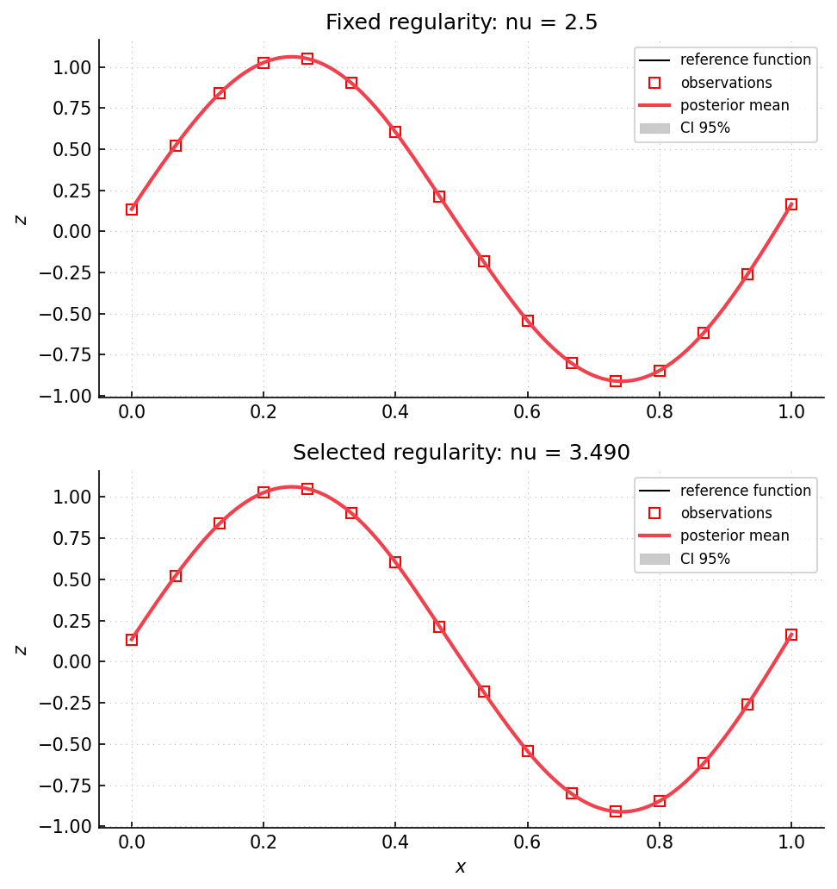

Example 06: fixed and selected Matérn regularity
================================================

Complete script: `examples/example06_matern.py <https://github.com/gpmp-dev/gpmp-contrib/blob/main/examples/example06_matern.py>`_

Purpose
-------

The script compares two REML models on the same one-dimensional observations.
``Model_ConstantMean_Maternp_REML`` fixes :math:`\nu=p+1/2`.
``Model_ConstantMean_Matern_REML`` selects :math:`\nu` with the process
variance and lengthscale.  The role of Matérn regularity is discussed by
:cite:t:`stein1999kriging` and :cite:t:`chiles1999geostatistics`.

Parameter vectors
-----------------

For an input dimension :math:`d`, the fixed-regularity model uses

.. code-block:: text

   [log(sigma2), -log(rho_0), ..., -log(rho_{d-1})]

The selected-regularity model adds ``log(nu)``:

.. code-block:: text

   [log(sigma2), log(nu), -log(rho_0), ..., -log(rho_{d-1})]

The logarithmic coordinate enforces :math:`\nu>0`.  The ``Param`` object names
this coordinate ``nu`` and stores it at path ``covparam/regularity``.

What is computed
----------------

- sixteen observations of a sine function with a local absolute-value term.
- one fixed model with ``p=2``, hence :math:`\nu=2.5`.
- one model with :math:`\nu` selected by REML.
- posterior means and variances on a regular grid.
- the selected regularity read through ``model[0].get_param()``.

Outputs
-------

The generated run prints the fixed and selected regularities followed by the
free-regularity ``Param`` object:

.. literalinclude:: ../_static/example_results/example06_matern_output.txt
   :language: text

The numerical value selected for :math:`\nu` depends on the observations,
criterion, bounds, and numerical backend.  The parameter name, path, and
positive denormalized value are stable parts of the interface.

   Both panels use the same observations.  The upper model fixes
   :math:`\nu=2.5`; the lower model selects :math:`\nu`.  Each shaded band is a
   pointwise 95 percent posterior interval.  Differences between the panels
   come from selecting the regularity with the other covariance parameters.

Run ``python examples/example06_matern.py`` from the repository root to execute
the script.  Regenerate the documented output and figure with
``cd docs && python make_example_results.py``.

Source excerpt
--------------

.. literalinclude:: ../../../examples/example06_matern.py
   :language: python
   :lines: 13-46
